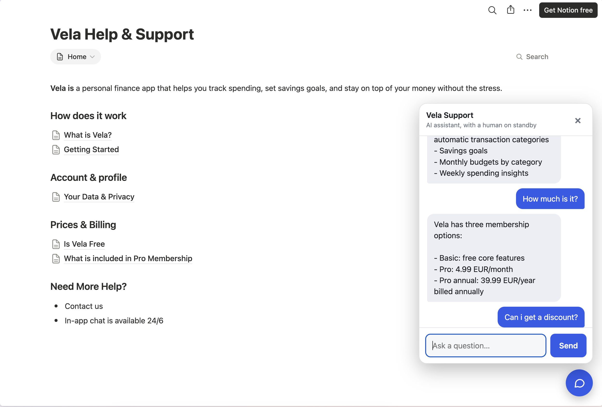
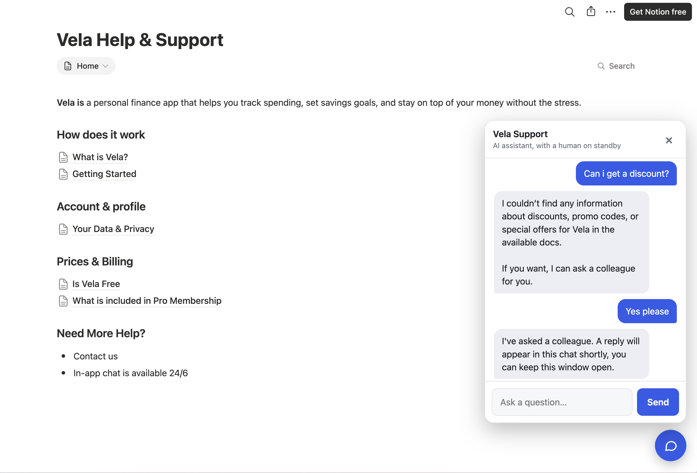
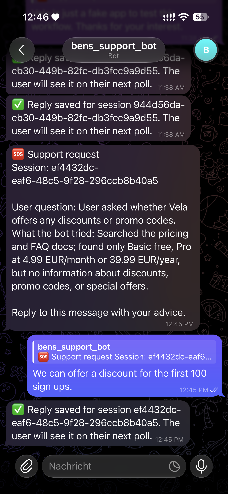
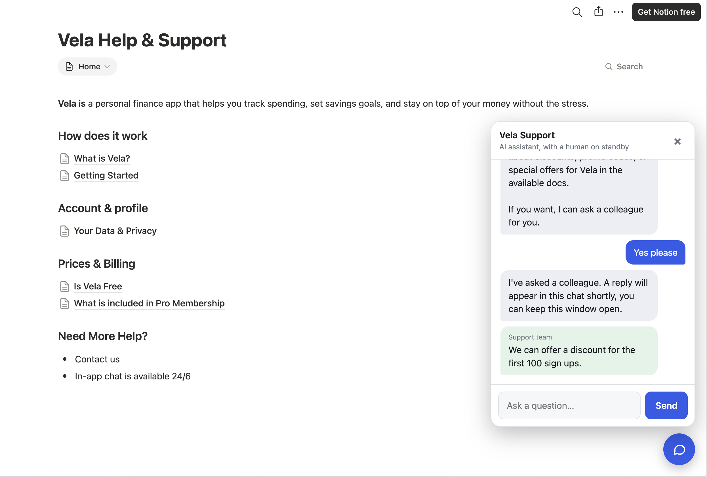

# Lab proof: Fully automated Help & Support Pages with Chatbot and Human escalation

**Entry point for the reviewer.** Everything below is backed by n8n execution **#2204** (the run shown in the screenshots) and the Data Table `support_escalations`. Execution #1981 is an earlier run, kept as evidence of a weakness (section 7).

## 1. Scenario

- **Who:** a solo support owner (me) running a website chatbot for a fictional finance app, "Vela".
- **Trigger:** the RAG chatbot can't answer, the user agrees to escalate, and the bot pings me on Telegram. I answer with Telegram's *Reply* button.
- **Lands in:** an n8n Data Table (`support_escalations`), one row per escalation. The website chat polls that table and shows my answer to the user.
- **Why it beats the manual way:** the answer finds its way back to the right visitor automatically, with an audit trail, instead of me copy-pasting between Telegram and a chat tool.
- **Behaviour in one sentence:** when I reply to a support ping on Telegram, store my advice against the visitor's session id so the chat can deliver it.

This is the "source event → destination record" part of a bigger single workflow (Notion → Pinecone RAG sync, RAG chatbot, polling endpoint; see 2b). The graded lab path is the 7 nodes in `workflow_export.json`.

## 2. Workflow export

[`workflow_export.json`](./workflow_export.json): the Telegram-reply path only, copied from the live workflow "Ben's Support Agent". Redacted: my chat id (`<OWNER_CHAT_ID>`) and credential ids. No tokens are in n8n exports (credentials are referenced by id).

```
Telegram Trigger → Is Owner Reply? (guard) → Extract Session and Advice (Set) → Has Session ID? → Save Reply (Data Table update) → Confirm Saved
                                                                                    └─ false → Warn No Match
```

## 2b. The rest of the system: automated RAG from the Notion Help & Support page

The Telegram path above is the graded source → destination mapping. It sits inside one n8n workflow, "Ben's Support Agent", which also keeps the chatbot's knowledge base current with no manual step:

```
Notion "Help & Support Pages" database
  ├─ page added   → Add Support Doc (Notion Trigger, polls every minute)
  │                 → Get many child blocks → Combine Blocks (Summarize: concatenate text)
  │                 → Store in Pinecone (OpenAI embeddings, 512 dims; metadata: pageId, title)
  └─ page updated → Update Support Doc (Notion Trigger)
                    → Delete Old Chunks (Pinecone delete by pageId filter)
                    → Get many child blocks → Combine Blocks → Store in Pinecone

Website chat → RAG Agent → Retrieve from Pinecone (+ Cohere rerank) → answer
                         └─ can't answer + user agrees → save_escalation (Data Table) + notify_human_telegram
```

The same Notion database is public and embedded next to the chat at https://tools.ben-mayer.com/support-bot/ (Notion site embed, `support-bot/index.html`). So visitors can browse the FAQ themselves, and the page they see is the one the bot is indexed from: editing a Notion page updates both the visible FAQ and, within about a minute, the bot's knowledge.

Design decisions worth a reviewer's attention:
- **Notion triggers return page properties only, not the body**, so a block-fetch node is required before embedding.
- **Updates delete first, then re-insert.** The n8n Pinecone node assigns random chunk ids, so inserting again would leave stale duplicates. Each chunk carries the Notion `pageId`, which lets the delete step remove exactly that page's old chunks.
- **The agent answers only from retrieved context** and escalates only after the user agrees, so a human is asked only when the docs run out.

Not captured in this proof: an execution id for the ingestion branches. The proof's graded trace is #2204. Known leftover: earlier manual test runs left duplicate chunks for one page in the index.

## 3. Source payload (Telegram Trigger output, execution #2204)

Names and chat ids redacted; everything else is verbatim.

```json
{
  "update_id": 471367369,
  "message": {
    "message_id": 12,
    "from": { "id": "<OWNER_CHAT_ID>", "is_bot": false, "first_name": "<owner>" },
    "chat": { "id": "<OWNER_CHAT_ID>", "type": "private" },
    "date": 1793792749,
    "reply_to_message": {
      "message_id": 11,
      "from": { "is_bot": true, "username": "bens_support_bot" },
      "date": 1793792707,
      "text": "🆘 Support request\nSession: ef4432dc-eaf6-48c5-9f28-296ccb8b40a5\n\nUser question: User asked whether Vela offers any discounts or promo codes.\nWhat the bot tried: Searched the pricing and FAQ docs; found only Basic free, Pro at 4.99 EUR/month or 39.99 EUR/year, but no information about discounts, promo codes, or special offers.\n\nReply to this message with your advice."
    },
    "text": "We can offer a discount for the first 100 sign ups."
  }
}
```

## 4. Destination record (Data Table `support_escalations`)

Destination schema, created before the mapping: `sessionId` (string), `question` (string), `status` (string), `reply` (string), `delivered` (boolean).

Row after the run (row `id` 3):

```json
{
  "sessionId": "ef4432dc-eaf6-48c5-9f28-296ccb8b40a5",
  "question": "User asked whether Vela offers any discounts or promo codes.",
  "status": "answered",
  "reply": "We can offer a discount for the first 100 sign ups.",
  "delivered": true,
  "createdAt": "2026-11-04T11:45:07.936Z",
  "updatedAt": "2026-11-04T11:45:54.555Z"
}
```

`question` and the row itself were created at 11:45:07 by the chatbot's `save_escalation` tool. Save Reply wrote `status`, `reply` and `delivered: false` at 11:45:50 (see trace). The polling flow then flipped `delivered` to `true` at 11:45:54 when the website fetched the reply, which is why `updatedAt` is later than the trace.

## 5. Mapping

| Destination column | Source / expression | Transform |
|---|---|---|
| `sessionId` (match key) | `message.reply_to_message.text` | regex `Session:\s*([A-Za-z0-9_-]+)`, first capture group |
| `reply` | `message.text` | none |
| `status` | literal | `answered` |
| `delivered` | literal | `false` (reset so the chat shows it once) |
| `question` | written earlier by the chatbot's `save_escalation` tool | not touched by this flow |

Guard (stretch): `Is Owner Reply?` only lets through messages whose chat id is mine **and** that are a Reply to a bot message. Anything else is ignored, so random users who find the bot can't write to the table.

## 6. Evidence: trigger, transform, final record (execution #2204)

Started `2026-11-04T11:45:50.039Z`, finished in 150 ms, status `success`, 6 nodes executed (the `Warn No Match` branch did not run).

| Stage | Node | Result |
|---|---|---|
| Trigger | Telegram Trigger | 1 item, the payload in section 3 |
| Guard | Is Owner Reply? | 1 item on the true branch |
| Transform | Extract Session and Advice | `{"sessionId":"ef4432dc-eaf6-48c5-9f28-296ccb8b40a5","advice":"We can offer a discount for the first 100 sign ups.","chatId":"<OWNER_CHAT_ID>"}` |
| Check | Has Session ID? | true branch (non-empty) |
| Final record | Save Reply | 1 row updated: `status: answered`, `reply` = advice, `delivered: false` |
| Feedback | Confirm Saved | 1 Telegram message "✅ Reply saved for session ef4432dc…" |

### End-to-end screenshots of this run

**1. Website, with the public Notion FAQ beside the chat.** The bot answers a pricing question from the indexed docs (Basic / Pro 4.99 EUR per month / Pro annual 39.99 EUR), then gets a question the docs can't answer.



**2. Escalation.** The bot says it found nothing about discounts, offers to ask a colleague, and after the visitor agrees tells them a reply will appear in the chat.



**3. Telegram.** The support ping with the session id and context, my Reply, and the "Reply saved" confirmation (the earlier messages at the top are from the older run in #1981).



**4. Website, human reply delivered.** The visitor sees my answer as a green "Support team" bubble without reloading.



The website widget (`support-bot/index.html`, deployed at https://tools.ben-mayer.com/support-bot/) holds no credentials. It only calls two public n8n webhooks.

## 7. Explain: what breaks first, and how I'd detect it

**The most fragile field is `sessionId`.** It isn't a field of the Telegram payload at all. I recover it by regex from the *text of the message I originally sent*, via `reply_to_message.text`. It breaks if:
- I answer without using Telegram's *Reply* (no `reply_to_message`),
- the bot message template changes (the `Session:` label moves or is renamed),
- Telegram changes the payload shape.

**Detection:** `Has Session ID?` checks that the regex produced a non-empty value. If not, the `Warn No Match` branch messages me immediately ("Couldn't find a session ID"), so a failure is loud instead of silently losing the answer.

**A second weakness I actually hit, and the data proves it:** the update matches on `sessionId` alone. The same visitor escalated twice in one session, so the table holds two rows with the same `sessionId` (ids 1 and 2). In execution #1981 `Save Reply` returned **2 items**, so one reply overwrote both rows and `Confirm Saved` fired twice, which is the pair of identical "Reply saved" messages (11:38 AM) at the top of the Telegram screenshot. The newer run (#2204, session `ef4432dc…`) has a single row, so it updated one row and sent one confirmation. Fix I'd apply next: give every escalation its own id, put that in the Telegram message instead of the session id, and match on it.

## 7b. Security notes

The widget calls two public n8n webhooks straight from the visitor's browser, so nothing in the page can be a real secret. A header-auth credential on those webhooks would not help: the header value would sit in the page source for anyone to copy.

**Controls in place**
- Credentials (Telegram, OpenAI, Pinecone, Cohere, Notion) live only in n8n; the widget and this repo contain none.
- CORS `allowedOrigins` on the Chat Trigger and the poll Webhook is limited to `https://tools.ben-mayer.com`.
- The poll endpoint only returns a reply for an exact session UUID, which can't be guessed, and shows each reply once (`delivered` flag).
- `Is Owner Reply?` accepts Telegram input only from my own chat id, so nobody else can write replies into the table.
- The widget renders all text with `textContent`, so model or human output can't inject HTML.

**Known risks**
- CORS only restricts browsers. Anyone who finds the chat URL can call it directly and spend OpenAI, Pinecone and Cohere credit or spam my Telegram with escalations.
- The poll webhook starts one n8n execution per call, so it can be flooded.

**Next step (not built)**
Put a small Cloudflare Worker on `tools.ben-mayer.com/api/*`. It would hold the header secret and add it server-side before forwarding to n8n, the n8n Webhook node would require that header credential, and a Cloudflare rate-limit rule would cap requests per IP. A secret only protects when the caller is a server I control.

## 8. Rubric note

`rubric.md` grades a Discord → Google Sheets variant. `instructions.md` allows any source/destination pair, and I used **Telegram → n8n Data Table**. I did not use Discord, Google Sheets or Google OAuth. Mapping of the criteria to what I built:

| Rubric item | Equivalent in this submission |
|---|---|
| Connect two apps in n8n (1, 11) | Telegram → Data Table, plus a website chat and Notion/Pinecone around it |
| Transform data between formats (2, 5, 8, 21) | Set node: nested Telegram JSON → flat row (section 5) |
| Credentials / OAuth setup (3, 7, 22) | Telegram bot token as an n8n credential (BotFather); Data Table needs none |
| Webhook / trigger setup (4, 6, 18, 19) | Telegram Trigger (webhook registered by n8n), instead of a Discord webhook |
| Destination created first, columns filled (16, 14) | `support_escalations` created with 5 columns before mapping |
| Workflow structure, test run, live run (17, 20, 23, 24) | Execution #2204 is a live run from a real Telegram message |
| Data appears correctly formatted (9, 10, 12, 13, 15) | Section 4 record matches the payload; execution finished without errors |

## 9. Prompt discipline (plan review prompt I used before building)

```text
Role: Workflow design reviewer
Task: Review my n8n event-flow plan before I build it.
Inputs: Telegram reply payload (section 3), destination schema (section 4: sessionId, question, status, reply, delivered), mapping table (section 5).
Constraints: Do not build the workflow for me. Identify brittle fields and missing checks.
Output format: three mapping risks, two verification checks, and one simplification.
Verification: Name the trace or record that proves the workflow ran correctly.
```

Trace/record that proves the run: **n8n execution #2204** and the row with `sessionId` `ef4432dc-eaf6-48c5-9f28-296ccb8b40a5` (row id 3) in `support_escalations`.
