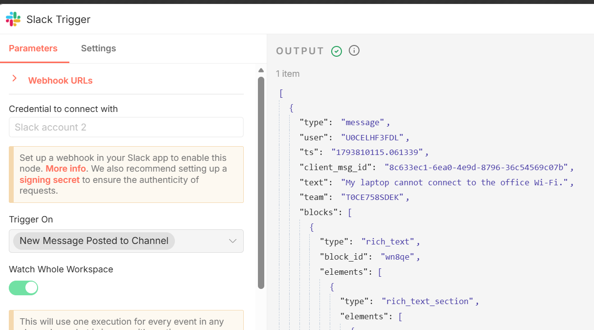

# Slack-to-Airtable Intake Workflow Proof

## Business case and objective

Our IT support team receives employee requests through Slack direct messages. I built this n8n workflow to filter eligible messages, extract the request details, and create a structured Airtable record. After creating a record, it replies in the same Slack conversation with a confirmation and two follow-up choices. The request ID combines the Slack user ID and message timestamp, making each request easier to find and track than an unstructured inbox message.

## Trigger → transformation → destination

**Slack Trigger → validation and field extraction → Airtable lookup/create → Slack acknowledgment**

The Slack trigger watches `message` events. `Valid DM?` allows only events where `channel_type` equals `im`, `bot_id` and `subtype` do not exist, and `text` is not empty. `Extract Fields` normalizes the source values and builds a request ID. The workflow searches Airtable by `request_id` and creates a record only when the search result has no `id`. After creation, it posts a confirmation to the source channel. The workflow export is [Integration_Slack_Airtable.json](./Integration_Slack_Airtable.json).

## Slack-to-Airtable field mapping

| Airtable field | Source or expression | Meaning |
|---|---|---|
| `request_id` | `REQ-{{ $json.user }}-{{ $json.ts }}` | Derived from the Slack user ID and message timestamp; also used for the duplicate lookup. |
| `slack_user_id` | `$json.user` | Slack user ID. |
| `slack_message_ts` | `$json.ts` | Slack message timestamp. |
| `description` | `$json.text` | Message text. |
| `status` | `NEW` | Literal initial status. |

`slack_channel` is also extracted from `$json.channel` and used as the acknowledgment destination; it is not mapped to an Airtable field in this export.

## Source-payload evidence

This is the Slack Trigger event payload for the laptop request:

```json
{
  "type": "message",
  "user": "U0CELHF3FDL",
  "ts": "1793810115.061339",
  "client_msg_id": "8c633ec1-6ea0-4e9d-8796-36c54569c07b",
  "text": "My laptop cannot connect to the office Wi-Fi.",
  "team": "T0CE758SDEK",
  "blocks": [
    {
      "type": "rich_text",
      "block_id": "wn8qe",
      "elements": [
        {
          "type": "rich_text_section",
          "elements": [
            {
              "type": "text",
              "text": "My laptop cannot connect to the office Wi-Fi."
            }
          ]
        }
      ]
    }
  ],
  "channel": "D0CEGB1JYNP",
  "event_ts": "1793810115.061339",
  "channel_type": "im"
}
```



The separate [edited-message filter screenshot](./evidence/Message_edit_filtering_test_passed.png) shows a `message_changed` event on the rejected branch.

## Execution evidence

| Evidence | What it shows |
|---|---|
| [n8n execution graph](./evidence/workflow_executed.png) | Shows the connected workflow nodes with successful execution indicators and an item moving through the intake path. |
| [Slack Trigger output](./evidence/slacj_trigger_output.png) | Shows the incoming laptop message and its Slack user ID, timestamp, and text. The event payload is transcribed above. |
| [Extract Fields input and output](./evidence/extract_fields_output.png) | Shows the input values and the normalized `slack_user_id`, `slack_message_ts`, `slack_channel`, `description`, and derived `request_id`. The user ID, timestamp, and description match the second Airtable row. |
| [Slack bot conversation](./evidence/Slack_BOT_production.png) | Shows employee messages and bot confirmations with request IDs and follow-up choices. The laptop request and its confirmation correspond to the second Airtable row by user ID and message timestamp. |
| [Airtable records](./evidence/airtable_records.png) | Shows two support-request rows with request IDs, creation times, Slack user IDs, message timestamps, descriptions, and `NEW` statuses. The second row matches the laptop request shown in Slack and n8n. |
| [Edited-message filter test](./evidence/Message_edit_filtering_test_passed.png) | Shows a `message_changed` payload on the false branch, as expected from the subtype check. |
| [Duplicate-check output](./evidence/duplicate_prevention_test_passed.png) | Shows a matching Airtable record on the false branch of `Is New Request?`, consistent with the workflow skipping the create path when a record is found. |

## Validation, operational risks, and limitations

- **Input validation:** The workflow accepts only direct messages (`channel_type = im`) with non-empty text and without a `bot_id` or `subtype`. The edited-message example follows the false branch.
- **Duplicate handling:** The workflow searches by `request_id` before creating a record. The lookup retries up to three times with a one-second interval. When a matching record is found, the workflow follows the false branch and does not proceed to the create node.
- **Acknowledgment:** Slack confirmation is sent after a new Airtable record is created. The workflow sends two interactive choices, but the export does not include a handler for button clicks. The duplicate branch does not send an acknowledgment.
- **Operational risks:** The export has no dedicated error-handling route, so failed Airtable or Slack operations need to be checked in n8n execution history. The lookup and create are separate steps rather than an atomic operation; simultaneous duplicate deliveries could race.


## Summary

I verified the request path using the Slack Trigger output, `Extract Fields` output, n8n execution, Slack confirmation, and Airtable records. The laptop request can be followed across these steps by its Slack user ID and timestamp, and its description is consistent in the source, transformation, and destination. The edited-message example shows the configured filter rejecting a changed message.